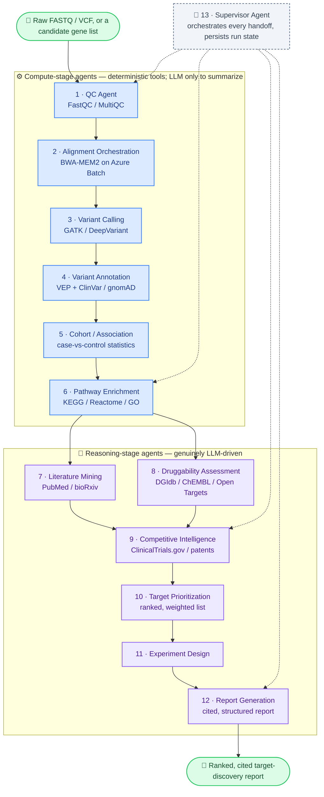

# TargetForge

A sequencing-to-insight drug target discovery pipeline for biotech/pharma R&D
teams. Give it a candidate gene list (or, eventually, raw sequencing data);
it runs pathway enrichment, mines real literature, checks druggability and
competitive landscape, and returns a ranked, cited, evidence-based report of
which targets are worth an R&D team's next experiment — with a proposed
experiment for each one.

12 specialist agents plus one supervisor coordinate the pipeline end to end.
See [`ARCHITECTURE.md`](ARCHITECTURE.md) for the full design and
[`docs/agents.md`](docs/agents.md) for every agent's exact contract.

## Architecture at a glance



Full per-agent contracts (inputs/outputs/tools/LLM usage) in [`docs/agents.md`](docs/agents.md); the reasoning behind the compute/reasoning split in [`ARCHITECTURE.md`](ARCHITECTURE.md).

## Status

**Pre-launch codebase, proven end-to-end — backend and frontend both.** The
candidate-gene-list entry point is fully real and has been exercised through
the actual HTTP API *and* through the React frontend in a real browser
(Playwright-verified), against live PubMed, DGIdb, ClinicalTrials.gov,
Ensembl VEP, and OpenAI — not mocked. The full FASTQ-to-report pipeline needs
real alignment/variant-calling compute this repo doesn't provision by
default; see [`docs/scaling-to-real-genomes.md`](docs/scaling-to-real-genomes.md)
for exactly what's left and why. Runs on public/reference data and
user-supplied gene lists only until
[`docs/compliance-checklist.md`](docs/compliance-checklist.md) is fully
checked off — no real subject sequencing data has touched this system.

## Repository layout

```
apps/api/          FastAPI service — the product's backend
  src/targetforge/
    agents/          12 pipeline agents (see docs/agents.md)
    bioinformatics/  Real statistics (Fisher's exact, hypergeometric enrichment) + Batch orchestration
    external/        Real clients: PubMed, DGIdb, ClinicalTrials.gov, Ensembl VEP
    orchestration/   The Supervisor — agent 13, coordinates all handoffs
    api/routers/     Thin HTTP layer (POST/GET /api/v1/runs)
    db/              SQLAlchemy models + Alembic migrations
  tests/
apps/web/           React + TypeScript SPA (Vite) — submit runs, watch pipeline stages, read the cited report
data/knowledge/     Curated pathway gene sets (config-as-code)
infra/bicep/        All Azure infrastructure, as code
docs/               Cost model, compliance checklist, runbook, scaling notes
```

## Quick start (local)

```
cp apps/api/.env.example apps/api/.env    # fill in OPENAI_API_KEY to run real agents, or leave blank for fakes
docker compose up -d                      # Postgres on host port 5434 — see docker-compose.yml
cd apps/api && pip install -e ".[dev]"
python -m alembic upgrade head
python -m uvicorn targetforge.main:app --reload
```
API docs at `http://localhost:8000/docs`. With `AI_PROVIDER=openai` and a
real `OPENAI_API_KEY`, every reasoning agent calls the real model; with no
`BATCH_ACCOUNT_URL` configured, alignment/variant-calling fall back to
in-repo fakes — see `apps/api/src/targetforge/deps.py`.

Trigger a real run:
```
curl -X POST http://localhost:8000/api/v1/runs \
  -H "Content-Type: application/json" \
  -d '{"candidate_genes": ["KRAS", "EGFR", "TP53"], "top_n_for_experiments": 2}'
```
Poll `GET /api/v1/runs/{id}` until `status` is `succeeded`; `report_json`
holds the full cited ranking.

Frontend:
```
cp apps/web/.env.example apps/web/.env.local
cd apps/web && npm install && npm run dev
```
Open `http://localhost:5173`. It talks straight to the API above — submit a
gene list, watch the pipeline stages update, read the cited report once it
finishes. No build step needed to see backend changes reflected.

## Running tests

```
cd apps/api
python -m pytest -q
```

The bioinformatics unit tests (`tests/unit/test_association_stats.py`,
`test_pathway_enrichment.py`, `test_fastq_qc.py`) are real statistics —
Fisher's exact test with Benjamini-Hochberg correction, hypergeometric
pathway enrichment — run with zero external dependencies.

## Deploying to Azure

See [`docs/runbook.md`](docs/runbook.md) for the full sequence. Nothing in
this repo talks to Azure until you run it.

## Read next

- [`ARCHITECTURE.md`](ARCHITECTURE.md) — the 12-agent pipeline design, and an
  explicit accounting of what's fully real vs. documented stand-in.
- [`docs/agents.md`](docs/agents.md) — every agent's input/output/tool/LLM-use
  contract.
- [`docs/production-readiness-audit.md`](docs/production-readiness-audit.md) —
  a 22-angle security/reliability/cost review (auth, ownership isolation,
  rate limiting, timeouts, dependency CVEs, and more) — what was found, what
  was fixed, and what's deliberately deferred and why.
- [`docs/cost-model.md`](docs/cost-model.md) — line-item Azure cost estimate,
  split by candidate-gene-list runs vs. real sequencing runs.
- [`docs/compliance-checklist.md`](docs/compliance-checklist.md) — why genomic
  data doesn't get the usual "just de-identify it" answer, and what has to be
  true before this system ever touches real subject sequencing data.
- [`docs/scaling-to-real-genomes.md`](docs/scaling-to-real-genomes.md) — the
  concrete path from today's candidate-gene-list pipeline to a real
  FASTQ-to-report run.
- [`docs/runbook.md`](docs/runbook.md) — local dev, first deploy, rollback,
  on-call basics.
